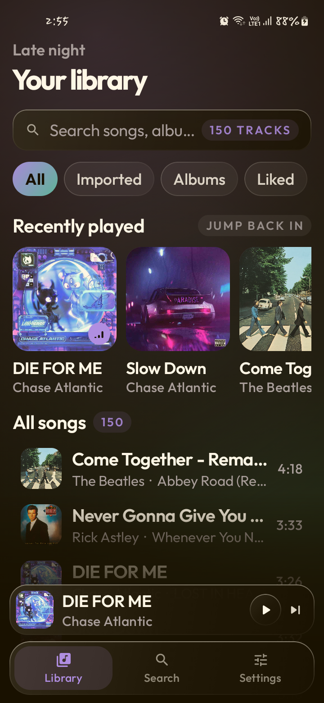

# Nocta

An AMOLED-black Android music player built around the songs you download with **Spotify Importer**.
It pairs every track with a Spotify-Canvas-style stage, animated synced lyrics and a liquid-glass UI
that tints itself with the current cover art.



## What it does

- **Library from your device** – reads every audio file in MediaStore, so anything Spotify Importer
  drops into `Music/SpotifyImporter` shows up (and is tagged as imported).
- **Canvas stage** – a living, breathing artwork stage for every song, or a looping `.mp4` clip when a
  sidecar exists. Works for songs without any video too.
- **Animated lyrics** – synced line-by-line with a karaoke-style accent fill, auto-centred and
  smooth-scrolling. Fetched from LRCLIB on first play, then cached on disk.
- **Clear liquid glass** – translucent panes you can read the library through, with accent-tinted
  sheen and top-lit hairline rims, floating over pure-black AMOLED.
- **Colour from the cover** – the accent follows album art (or pick Violet / Mint / Amber / Rose / Ice),
  with an optional soft crossfade between songs.
- **Real background playback** – Media3 / ExoPlayer session with notification controls, queue sheet,
  shuffle, repeat and seek.

## Requirements

- Android 8.0 (API 26) or newer, with MediaStore-visible audio.
- The songs already downloaded by Spotify Importer (or any local audio).
- Network only for the first lyric fetch per song.

## Install

Prebuilt APKs are written to:

```
app/build/outputs/apk/debug/app-debug.apk      # com.nocta.player.debug – use this for testing
app/build/outputs/apk/release/app-release.apk  # com.nocta.player     – normal install
```

```powershell
adb install -r app\build\outputs\apk\release\app-release.apk
```

The release APK is signed with the local debug keystore so it installs directly; swap in your own
keystore before distributing it.

On first launch tap **Allow access** so Nocta can read your audio library.

## Sidecar files (optional)

Nocta works without these, but they unlock the full experience. Both are matched by the song's
`Artist - Title` filename and can use any extension Spotify Importer gave the track:

```
Music/SpotifyImporter/
  Chase Atlantic - SLIDE.mp3      ← song
  Chase Atlantic - SLIDE.lrc      ← synced (or plain) lyrics
  Chase Atlantic - SLIDE.mp4      ← looping canvas clip (.mp4 / .webm / .mov / .m4v / .mkv)
```

To let Nocta read them, open **Settings → Connect music folder** and pick the folder
(`Music/SpotifyImporter`). Android's Storage Access Framework doesn't let the app read sidecars
otherwise, even with audio permission. After adding files, use **Settings → Rescan library**.

Without a folder link: lyrics come from LRCLIB (cached in `files/lyrics`) and the stage is the
generative canvas.

## Using it

| Action | Where |
| --- | --- |
| Play / pause, next | Mini player above the tab bar |
| Open the full player | Tap the mini player |
| Queue | Player → top-right playlist icon, or **Up next** pill |
| Lyrics | **Lyrics** pill in the player |
| Filters | Library chips: All · Imported · Albums · Liked |
| Search | Search tab, or the search field on the Library screen |
| Like a song | Heart button in the player; liked tracks get their own library view |

## Settings

- **Accent** – Album (follows cover art) or a fixed colour.
- **Canvas video** – use `.mp4` sidecars when present.
- **Ambient motion** – breathing artwork, drifting light, floating dust.
- **Karaoke lyrics** – fill each line as the song plays.
- **Soft crossfade** – blend accent colours when the track changes.
- **Library** – rescan, connect folder, clear the lyric cache.

## Build from source

Requires JDK 17 and the Android SDK (compileSdk 34).

```powershell
$env:JAVA_HOME="C:\Users\Gemy\AppData\Local\AndroidJdk17\jdk-17.0.20.1+1"
.\gradlew.bat assembleDebug        # or assembleRelease
```

Stack: Kotlin 1.9, Jetpack Compose (BOM 2024.02), Media3 1.2.1, Coil 2.5, Palette, OkHttp.

## Known limits

- Duplicate files for the same title + artist (e.g. `Song.mp3` and `Song (1).mp3`) are collapsed into
  one row.
- The glass look is a layered translucent recipe rather than a live backdrop blur: real blur is
  expensive on Android 12 and silently degrades on many devices, so it is not used. The backdrop
  light pools are static (drawn once per resize) to keep scrolling at full frame rate.
- Lyrics are matched by title/artist/album/duration; unusual titles or live edits may miss.
- Nocta only reads audio — it never modifies your files.
